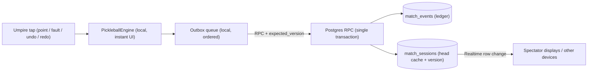

# PikolScore: Supabase Migration Spec (v2)

> **Stack:** Next.js 15 (App Router), `@supabase/supabase-js` v2, Supabase Postgres  
> **Scope:** Move scoreboard state, undo/redo, match log, timer and session ownership from `localStorage` to Supabase.  
> **Status:** Design approved, not yet implemented. All SQL in this document must be **run manually** in the Supabase SQL Editor (the Supabase MCP tool is not connected).

---

## 0. Key Decisions & Design Summary

| # | Decision | Choice |
|---|---|---|
| D1 | Undo/redo scope | **Option B: cloud-synced.** Undo/redo state lives in Supabase, so any authorised device sees the same history. |
| D2 | Rally storage | **Granular `public.match_events`.** One row per point/fault, kept for analytics and post-game review. |
| D3 | How Option B is implemented | **Event-status ledger, not a `jsonb` snapshot stack.** Undo/redo flip a `status` flag on event rows. Each row carries `state_after`, so no separate snapshot array is stored. |

### Why the ledger instead of a `jsonb` snapshot stack
This choice removes the biggest downsides identified earlier:

| Risk with a `jsonb` snapshot stack | How the ledger avoids it |
|---|---|
| Two sources of truth (snapshot stack vs. event log) can drift apart | The event table **is** the stack. `match_sessions` holds only a cached copy of the head state. |
| Row bloat, TOAST storage and high WAL volume as the stack grows | Each event row is about 300 bytes and never grows. No undo cap is needed. |
| Deleting rows on undo breaks analytics and realtime listeners | Rows are never deleted. Undone rallies stay for auditing, and analytics filter on `status = 'active'`. |
| Large realtime payloads | Realtime broadcasts only the small `match_sessions` row. |



---

## 1. Current State Audit: `localStorage` Usage

| File | Key | Op | Trigger | Data |
|---|---|---|---|---|
| `hooks/useScoreboard.js` | `pikolscore_v3` | `setItem` | `syncState()` after `point`, `fault`, `undo`, `redo`, `reset`, `setTeamName`, `setTeamPalette` | `{ snapshot, history[], redoStack[] }` (all serialized engine snapshots) |
| `hooks/useScoreboard.js` | `pikolscore_v3` | `getItem` | Mount | Restores snapshot + stacks |
| `hooks/useMatchTimer.js` | `pikolscore_timer_v2` | `setItem` | `start`, `pause`, `resume`, `reset`, expiry | `{ status, remainingMs, endsAt }` |
| `hooks/useMatchTimer.js` | `pikolscore_timer_v2` | `getItem` | Mount | Recomputes remaining from `endsAt - Date.now()` |
| `lib/auth-session.js` | `pikol_saved_accounts` | `getItem` / `setItem` | Login mount, soft logout, account removal | Up to 5 MRU accounts incl. refresh tokens. **Stays device-local (not migrated).** |
| `lib/auth-session.js` | `sb-*-auth-token` | `removeItem` | Soft logout (`components/layout/Header.jsx`) | Supabase session token. **Managed by Supabase (not migrated).** |

### Current payloads

```json
// pikolscore_v3
{
  "snapshot": "{\"format\":\"doubles\",\"scores\":[1,0],\"servingTeam\":0,\"serverNumber\":2,\"courtPositions\":[{\"left\":\"Player 2\",\"right\":\"Player 1\"},{\"left\":\"Player 4\",\"right\":\"Player 3\"}],\"serverCourt\":\"left\",\"gameOver\":false,\"winner\":null,\"teamPalettes\":[\"omega\",\"alpha\"],\"teamNames\":[\"Team Omega\",\"Team Alpha\"],\"teamKeys\":[\"omega\",\"alpha\"],\"log\":[{\"elapsed\":25,\"message\":\"Team Omega scored\",\"call\":\"1–0–2\",\"e\":25,\"m\":\"Team Omega scored\",\"sc\":\"1–0–2\"}]}",
  "history": ["{...previous snapshot...}"],
  "redoStack": []
}

// pikolscore_timer_v2
{ "status": "running", "remainingMs": 1785000, "endsAt": 1791989234000 }
```

### Current limitations being fixed
- **No session ID.** A match exists only implicitly in one browser.
- **No user link.** The match isn't tied to the authenticated umpire.
- **Log entries are display strings only** (`message`, `call`, `elapsed`). Nobody records which team scored or what the state was.
- **Snapshots are stored as JSON strings inside JSON** (double-encoded).

---

## 2. Current Engine & Hook Behaviour (unchanged by migration)

`lib/engine.js` (`PickleballEngine`) remains the **single implementation of the scoring rules**. The migration adds persistence around it and does not rewrite it.

| Action | Engine method | Rule behaviour |
|---|---|---|
| Point | `pointWon(elapsed)` | Pushes snapshot to `history`, clears `redoStack`. Increments serving team score. In doubles, swaps court positions and toggles `serverCourt`. Win at `>= 11` and lead `>= 2`. Appends log. |
| Fault | `fault(elapsed)` | Pushes snapshot, clears `redoStack`. Doubles: server 1 → server 2, or server 2 → side out (`serverNumber = 1`, `serverCourt = 'right'`). Singles: side out. Appends log. |
| Undo / Redo | `undo()` / `redo()` | **Full-snapshot** stacks (not event replay). Any new action clears redo. |
| Timer | `useMatchTimer` | 30-minute countdown, 250 ms tick from `endsAt`, Screen Wake Lock while running. |

`Scoreboard.jsx` coordinates both hooks, gates all actions behind `isGuest` (`?demo=1` or no session), and opens `GameWonModal` + pauses the timer on `gameOver`.

---

## 3. Target Data Model (TypeScript)

```typescript
export type MatchFormat = 'singles' | 'doubles';
export type TeamIndex = 0 | 1;
export type ServerNumber = 1 | 2;
export type ServerCourt = 'right' | 'left';
export type SessionStatus = 'in_progress' | 'completed' | 'abandoned';
export type TimerStatus = 'idle' | 'running' | 'paused' | 'expired';
export type RallyEventType = 'point' | 'secondServer' | 'sideOut' | 'gameWon';
export type EventStatus = 'active' | 'undone' | 'discarded';

/** Engine state after a rally. Same shape as saveSnapshot() minus log/team metadata. */
export interface RallyState {
  format: MatchFormat;
  scores: [number, number];
  servingTeam: TeamIndex;
  serverNumber: ServerNumber;
  serverCourt: ServerCourt;
  courtPositions: [{ left: string; right: string }, { left: string; right: string }];
  gameOver: boolean;
  winner: TeamIndex | null;
}

export interface MatchSessionRow {
  id: string;                       // uuid, generated on client
  umpire_id: string;                // = auth.uid()
  format: MatchFormat;
  target_score: number;             // 11
  win_by: number;                   // 2
  status: SessionStatus;
  team_keys: [string, string];
  team_names: [string, string];
  team_palettes: [string, string];
  player_names: { team0: string[]; team1: string[] };
  initial_state: RallyState;        // state before the first rally (undo floor)
  // Head-state cache (copied from newest active event, or initial_state)
  score_team0: number;
  score_team1: number;
  serving_team: TeamIndex;
  server_number: ServerNumber;
  server_court: ServerCourt;
  court_positions: RallyState['courtPositions'];
  winner_team: TeamIndex | null;
  // Concurrency
  head_sequence: number;            // last allocated event sequence
  version: number;                  // incremented on every rally/undo/redo
  // Timer
  timer_status: TimerStatus;
  timer_duration_ms: number;
  timer_remaining_ms: number;
  timer_ends_at: string | null;     // ISO timestamp
  timer_updated_at: string;
  // Legacy import
  legacy_log: Array<{ elapsed: number; message: string; call: string }> | null;
  completed_at: string | null;
  created_at: string;
  updated_at: string;
}

export interface MatchEventRow {
  id: string;                       // uuid, generated on client (idempotency key)
  session_id: string;
  sequence: number;                 // 1..n, unique per session
  status: EventStatus;
  event_type: RallyEventType;
  elapsed_seconds: number;
  state_after: RallyState;
  call_string: string;              // "1–0–2"
  message: string;                  // "Team Omega scored"
  created_by: string;
  created_at: string;
  status_changed_at: string;
}
```

---

## 4. Undo/Redo Ledger Semantics

| Action | Ledger change | New head state |
|---|---|---|
| **Point / Fault** | Mark all `undone` rows `discarded` (clears redo). Insert new row at `head_sequence + 1` with status `active`. | New row's `state_after` |
| **Undo** | Newest `active` row → `undone` | Next-newest `active` row's `state_after`, or `initial_state` if none |
| **Redo** | Oldest `undone` row → `active` | That row's `state_after` |
| **Read current state** | `match_sessions` cache columns | (no ledger scan needed) |
| **Analytics** | `WHERE status = 'active'` | (undone and discarded rows kept for audit) |

Example sequence:

```
seq  type          status       after action
1    sideOut       active
2    point         active
3    secondServer  active       ← undo  → seq 3 becomes 'undone'
3    secondServer  undone       ← redo  → seq 3 becomes 'active' again
3    secondServer  undone       ← new point instead → seq 3 'discarded', seq 4 inserted 'active'
```

---

## 5. Database Schema

```sql
-- =========================================================
-- 5.1 match_sessions
-- =========================================================
create table public.match_sessions (
  id                 uuid primary key,
  umpire_id          uuid not null default auth.uid() references public.profiles(id) on delete restrict,
  format             text not null default 'doubles' check (format in ('singles','doubles')),
  target_score       smallint not null default 11 check (target_score between 1 and 99),
  win_by             smallint not null default 2  check (win_by between 1 and 10),
  status             text not null default 'in_progress' check (status in ('in_progress','completed','abandoned')),

  team_keys          jsonb not null default '["omega","alpha"]'::jsonb,
  team_names         jsonb not null default '["Team Omega","Team Alpha"]'::jsonb,
  team_palettes      jsonb not null default '["omega","alpha"]'::jsonb,
  player_names       jsonb not null default '{"team0":["Player 1","Player 2"],"team1":["Player 3","Player 4"]}'::jsonb,
  initial_state      jsonb not null,

  -- head-state cache
  score_team0        smallint not null default 0 check (score_team0 between 0 and 99),
  score_team1        smallint not null default 0 check (score_team1 between 0 and 99),
  serving_team       smallint not null default 0 check (serving_team in (0,1)),
  server_number      smallint not null default 2 check (server_number in (1,2)),
  server_court       text not null default 'right' check (server_court in ('right','left')),
  court_positions    jsonb not null,
  winner_team        smallint check (winner_team in (0,1)),

  -- concurrency
  head_sequence      integer not null default 0,
  version            integer not null default 0,

  -- timer
  timer_status       text not null default 'idle' check (timer_status in ('idle','running','paused','expired')),
  timer_duration_ms  integer not null default 1800000 check (timer_duration_ms > 0),
  timer_remaining_ms integer not null default 1800000 check (timer_remaining_ms >= 0),
  timer_ends_at      timestamptz,
  timer_updated_at   timestamptz not null default now(),

  legacy_log         jsonb,
  completed_at       timestamptz,
  created_at         timestamptz not null default now(),
  updated_at         timestamptz not null default now()
);

create index idx_match_sessions_umpire_status on public.match_sessions (umpire_id, status, updated_at desc);

-- =========================================================
-- 5.2 match_events (ledger)
-- =========================================================
create table public.match_events (
  id                uuid primary key,
  session_id        uuid not null references public.match_sessions(id) on delete cascade,
  sequence          integer not null check (sequence > 0),
  status            text not null default 'active' check (status in ('active','undone','discarded')),
  event_type        text not null check (event_type in ('point','secondServer','sideOut','gameWon')),
  elapsed_seconds   integer not null default 0 check (elapsed_seconds >= 0),
  state_after       jsonb not null check (
                      jsonb_typeof(state_after->'scores') = 'array'
                      and (state_after->'scores'->>0)::int between 0 and 99
                      and (state_after->'scores'->>1)::int between 0 and 99
                      and (state_after->>'servingTeam')::int in (0,1)
                      and (state_after->>'serverNumber')::int in (1,2)
                      and state_after->>'serverCourt' in ('right','left')
                    ),
  call_string       text not null,
  message           text not null,
  created_by        uuid not null default auth.uid(),
  created_at        timestamptz not null default now(),
  status_changed_at timestamptz not null default now(),
  unique (session_id, sequence)
);

create index idx_match_events_session_status_seq on public.match_events (session_id, status, sequence);
```

---

## 6. Atomic RPCs (the only write path)

All writes go through `SECURITY DEFINER` functions. Each function locks the session row, checks ownership, status and version, then updates the ledger and the head cache **in one transaction**.

| Error code | Meaning | Client response |
|---|---|---|
| `42501` `forbidden` | Not the session owner | Stop sync and show an error |
| `P0001` `session_closed` | Session not `in_progress` | Stop sync and reload |
| `40001` `version_conflict` | Another device changed the match | Pause outbox, refetch, rehydrate (see 7.3) |
| `P0002` `nothing_to_undo` / `nothing_to_redo` | Stack empty on server | Refetch and rehydrate |

```sql
-- ---------------------------------------------------------
-- 6.0 Internal helper: write head state into the cache
-- ---------------------------------------------------------
create or replace function public._apply_head_state(p_session_id uuid, p_state jsonb)
returns public.match_sessions
language sql
set search_path = public
as $$
  update public.match_sessions set
    score_team0     = (p_state->'scores'->>0)::smallint,
    score_team1     = (p_state->'scores'->>1)::smallint,
    serving_team    = (p_state->>'servingTeam')::smallint,
    server_number   = (p_state->>'serverNumber')::smallint,
    server_court    = p_state->>'serverCourt',
    court_positions = p_state->'courtPositions',
    winner_team     = case when coalesce((p_state->>'gameOver')::boolean, false)
                           then (p_state->>'winner')::smallint end,
    version         = version + 1,
    updated_at      = now()
  where id = p_session_id
  returning *;
$$;

-- ---------------------------------------------------------
-- 6.1 Internal helper: lock + guard
-- ---------------------------------------------------------
create or replace function public._lock_session(p_session_id uuid, p_expected_version int)
returns public.match_sessions
language plpgsql
set search_path = public
as $$
declare s public.match_sessions;
begin
  select * into s from public.match_sessions where id = p_session_id for update;
  if not found or s.umpire_id <> auth.uid() then
    raise exception 'forbidden' using errcode = '42501';
  end if;
  if s.status <> 'in_progress' then
    raise exception 'session_closed' using errcode = 'P0001';
  end if;
  if p_expected_version is not null and s.version <> p_expected_version then
    raise exception 'version_conflict' using errcode = '40001';
  end if;
  return s;
end $$;

-- ---------------------------------------------------------
-- 6.2 Create session (idempotent)
-- ---------------------------------------------------------
create or replace function public.fn_create_session(
  p_session_id uuid,
  p_format text,
  p_team_keys jsonb,
  p_team_names jsonb,
  p_team_palettes jsonb,
  p_player_names jsonb,
  p_initial_state jsonb,
  p_timer_duration_ms int default 1800000,
  p_legacy_log jsonb default null
) returns public.match_sessions
language plpgsql security definer
set search_path = public
as $$
declare s public.match_sessions;
begin
  if auth.uid() is null then
    raise exception 'forbidden' using errcode = '42501';
  end if;

  insert into public.match_sessions (
    id, umpire_id, format, team_keys, team_names, team_palettes, player_names,
    initial_state, court_positions, timer_duration_ms, timer_remaining_ms, legacy_log
  ) values (
    p_session_id, auth.uid(), p_format, p_team_keys, p_team_names, p_team_palettes, p_player_names,
    p_initial_state, p_initial_state->'courtPositions', p_timer_duration_ms, p_timer_duration_ms, p_legacy_log
  )
  on conflict (id) do nothing;

  select * into s from public.match_sessions where id = p_session_id;
  if s.umpire_id <> auth.uid() then
    raise exception 'forbidden' using errcode = '42501';
  end if;

  -- Seed head cache from initial_state on first creation (version 0 → 1)
  if s.version = 0 then
    s := public._apply_head_state(p_session_id, p_initial_state);
  end if;
  return s;
end $$;

-- ---------------------------------------------------------
-- 6.3 Record rally (point / fault), idempotent on p_event_id
-- ---------------------------------------------------------
create or replace function public.fn_record_rally(
  p_session_id uuid,
  p_event_id uuid,
  p_expected_version int,
  p_event_type text,
  p_elapsed_seconds int,
  p_state_after jsonb,
  p_call_string text,
  p_message text
) returns public.match_sessions
language plpgsql security definer
set search_path = public
as $$
declare s public.match_sessions;
begin
  -- Lock without version check first so a retried request can be detected
  s := public._lock_session(p_session_id, null);

  -- Idempotent retry: event already stored → return current state
  if exists (select 1 from public.match_events where id = p_event_id) then
    return s;
  end if;

  if s.version <> p_expected_version then
    raise exception 'version_conflict' using errcode = '40001';
  end if;

  -- New action clears redo stack
  update public.match_events
     set status = 'discarded', status_changed_at = now()
   where session_id = p_session_id and status = 'undone';

  insert into public.match_events (
    id, session_id, sequence, event_type, elapsed_seconds, state_after, call_string, message
  ) values (
    p_event_id, p_session_id, s.head_sequence + 1, p_event_type,
    greatest(0, p_elapsed_seconds), p_state_after, p_call_string, p_message
  );

  update public.match_sessions set head_sequence = head_sequence + 1 where id = p_session_id;
  return public._apply_head_state(p_session_id, p_state_after);
end $$;

-- ---------------------------------------------------------
-- 6.4 Undo
-- ---------------------------------------------------------
create or replace function public.fn_undo_rally(p_session_id uuid, p_expected_version int)
returns public.match_sessions
language plpgsql security definer
set search_path = public
as $$
declare
  s public.match_sessions;
  v_target_id uuid;
  v_head jsonb;
begin
  s := public._lock_session(p_session_id, p_expected_version);

  select id into v_target_id from public.match_events
   where session_id = p_session_id and status = 'active'
   order by sequence desc limit 1;

  if v_target_id is null then
    raise exception 'nothing_to_undo' using errcode = 'P0002';
  end if;

  update public.match_events
     set status = 'undone', status_changed_at = now()
   where id = v_target_id;

  select state_after into v_head from public.match_events
   where session_id = p_session_id and status = 'active'
   order by sequence desc limit 1;

  return public._apply_head_state(p_session_id, coalesce(v_head, s.initial_state));
end $$;

-- ---------------------------------------------------------
-- 6.5 Redo
-- ---------------------------------------------------------
create or replace function public.fn_redo_rally(p_session_id uuid, p_expected_version int)
returns public.match_sessions
language plpgsql security definer
set search_path = public
as $$
declare
  s public.match_sessions;
  v_target_id uuid;
  v_head jsonb;
begin
  s := public._lock_session(p_session_id, p_expected_version);

  select id, state_after into v_target_id, v_head from public.match_events
   where session_id = p_session_id and status = 'undone'
   order by sequence asc limit 1;

  if v_target_id is null then
    raise exception 'nothing_to_redo' using errcode = 'P0002';
  end if;

  update public.match_events
     set status = 'active', status_changed_at = now()
   where id = v_target_id;

  return public._apply_head_state(p_session_id, v_head);
end $$;

-- ---------------------------------------------------------
-- 6.6 Timer (last-write-wins by client timestamp; does NOT bump version)
-- ---------------------------------------------------------
create or replace function public.fn_set_timer(
  p_session_id uuid,
  p_status text,
  p_remaining_ms int,
  p_ends_at timestamptz,
  p_client_ts timestamptz
) returns public.match_sessions
language plpgsql security definer
set search_path = public
as $$
declare s public.match_sessions;
begin
  s := public._lock_session(p_session_id, null);
  if p_client_ts <= s.timer_updated_at then
    return s; -- stale or duplicate timer update
  end if;

  update public.match_sessions set
    timer_status       = p_status,
    timer_remaining_ms = greatest(0, p_remaining_ms),
    timer_ends_at      = p_ends_at,
    timer_updated_at   = p_client_ts,
    updated_at         = now()
  where id = p_session_id
  returning * into s;
  return s;
end $$;

-- ---------------------------------------------------------
-- 6.7 Close session ("Start New Match" or abandon)
-- ---------------------------------------------------------
create or replace function public.fn_close_session(p_session_id uuid, p_status text)
returns public.match_sessions
language plpgsql security definer
set search_path = public
as $$
declare s public.match_sessions;
begin
  if p_status not in ('completed','abandoned') then
    raise exception 'invalid_status' using errcode = '22023';
  end if;
  s := public._lock_session(p_session_id, null);

  update public.match_sessions set
    status       = case when s.winner_team is not null then 'completed' else p_status end,
    completed_at = now(),
    timer_status = case when timer_status = 'running' then 'paused' else timer_status end,
    updated_at   = now()
  where id = p_session_id
  returning * into s;
  return s;
end $$;

-- ---------------------------------------------------------
-- 6.8 Permissions
-- ---------------------------------------------------------
revoke all on function public._apply_head_state(uuid, jsonb) from public, anon, authenticated;
revoke all on function public._lock_session(uuid, int)       from public, anon, authenticated;

revoke all on function public.fn_create_session(uuid, text, jsonb, jsonb, jsonb, jsonb, jsonb, int, jsonb) from public, anon;
revoke all on function public.fn_record_rally(uuid, uuid, int, text, int, jsonb, text, text)            from public, anon;
revoke all on function public.fn_undo_rally(uuid, int)                                                  from public, anon;
revoke all on function public.fn_redo_rally(uuid, int)                                                  from public, anon;
revoke all on function public.fn_set_timer(uuid, text, int, timestamptz, timestamptz)                   from public, anon;
revoke all on function public.fn_close_session(uuid, text)                                              from public, anon;

grant execute on function public.fn_create_session(uuid, text, jsonb, jsonb, jsonb, jsonb, jsonb, int, jsonb) to authenticated;
grant execute on function public.fn_record_rally(uuid, uuid, int, text, int, jsonb, text, text)            to authenticated;
grant execute on function public.fn_undo_rally(uuid, int)                                                  to authenticated;
grant execute on function public.fn_redo_rally(uuid, int)                                                  to authenticated;
grant execute on function public.fn_set_timer(uuid, text, int, timestamptz, timestamptz)                   to authenticated;
grant execute on function public.fn_close_session(uuid, text)                                              to authenticated;
```

> [!NOTE]
> The helpers `_apply_head_state` and `_lock_session` are not `SECURITY DEFINER`. They run with the privileges of the calling `SECURITY DEFINER` RPC, and `authenticated` cannot call them directly.

---

## 7. Guardrails

### 7.1 Atomicity
- Clients **never** call `.insert()`, `.update()` or `.delete()` on `match_sessions` or `match_events`. RLS has no write policies, so direct writes are rejected.
- Every rally, undo and redo is one RPC, which is one transaction. The ledger and the head cache can't drift apart.

### 7.2 Idempotency
- The client generates `p_event_id` with `crypto.randomUUID()` **before** queueing the request. A retried `fn_record_rally` returns the current state instead of inserting a duplicate.
- `fn_create_session` uses `on conflict do nothing` with a client-generated session ID.
- Timer updates are deduplicated by `p_client_ts`.
- Undo and redo are guarded by `p_expected_version`. A retry after a successful but unacknowledged call fails with `version_conflict`. The client handles this by refetching (7.3), which converges to the correct state.

### 7.3 Optimistic concurrency (multi-device)
- The client tracks `localVersion` from the last server response. Each queued operation carries the version it expects, and successive operations chain `+1`.
- On `version_conflict`:
  1. Pause the outbox.
  2. Refetch the session and its events.
  3. Rehydrate the engine (7.5).
  4. Drop the remaining queued rally/undo/redo operations and show a toast: *"Score was updated on another device. N pending taps were not applied."*
- **Server wins.** Taps are never silently merged.
- Timer updates don't bump `version`, so toggling the timer never conflicts with scoring.

### 7.4 Offline-first outbox
- The engine still updates the UI instantly on every tap. Network work is asynchronous.
- Outbox persisted in `localStorage` key `pikolscore_outbox_v1` as an ordered array of `{ op, args, expectedVersion, enqueuedAt }`.
- The outbox is sent **strictly in order, one request at a time**. An item is removed only after the server acknowledges it.
- Retry with exponential backoff (1 s, 2 s, 4 s … max 30 s). Flush on the browser `online` event and when the tab becomes visible.
- Header shows a sync indicator: `Synced` / `Syncing (N)` / `Offline (N pending)`.
- `pikolscore_active_session_id` in `localStorage` remembers which session to resume after a reload.

### 7.5 Engine hydration adapter (`lib/hydrate.js`)
On load, or after a conflict, rebuild the engine from the server so local undo/redo matches the cloud:

```
activeEvents = events where status='active' order by sequence
undoneEvents = events where status='undone'  order by sequence

states  = [session.initial_state, ...activeEvents.map(e => e.state_after)]
logs_k  = activeEvents[0..k].map(e => ({ elapsed, message: e.message, call: e.call_string }))

engine.restoreSnapshot(toSnapshot(states[last], logs_all, teamMeta))
engine.history   = states[0..last-1].map((st, k) => toSnapshot(st, logs_k, teamMeta))
engine.redoStack = undoneEvents.reverse().map(...)   // top of stack = oldest undone
```

`lib/engine.js` itself needs no changes.

### 7.6 Data validation
- `CHECK` constraints cover scores (0–99), `serving_team` (0/1), `server_number` (1/2), `server_court`, `format`, `status` and `event_type`.
- The RPCs refuse any write to a session that isn't `in_progress`.
- *(Phase 2, optional)* Port the transition rules into SQL to verify that each `state_after` follows from the previous head. Until then the database trusts the client engine within the constraint bounds.

### 7.7 Row Level Security

```sql
alter table public.match_sessions enable row level security;
alter table public.match_events   enable row level security;

-- Umpire sees own sessions
create policy "umpire_select_own_sessions" on public.match_sessions
  for select to authenticated
  using (umpire_id = auth.uid());

-- Spectators (anon + any signed-in user) read live/completed sessions
create policy "spectator_select_public_sessions" on public.match_sessions
  for select to anon, authenticated
  using (status in ('in_progress','completed'));

-- Events visible when the parent session is visible
create policy "select_events_of_visible_sessions" on public.match_events
  for select to anon, authenticated
  using (exists (
    select 1 from public.match_sessions s
     where s.id = match_events.session_id
       and (s.umpire_id = auth.uid() or s.status in ('in_progress','completed'))
  ));

-- No insert/update/delete policies: all writes go through SECURITY DEFINER RPCs.
```

> [!WARNING]
> `spectator_select_public_sessions` makes every live and completed match readable by anyone who knows or can list the IDs. If matches should be private, replace it with a share-token or per-venue policy (see Open Decision Q4).

### 7.8 Timer persistence
- Only state changes are persisted (`start`, `pause`, `resume`, `reset`, `expire`), as `timer_status`, `timer_remaining_ms` and `timer_ends_at`.
- The 250 ms tick, the warning state and the countdown sounds stay local.
- On hydrate, `remaining = max(0, timer_ends_at − now())` when the timer is `running`. This matches today's logic.

### 7.9 Realtime
- `alter publication supabase_realtime add table public.match_sessions;`
- Clients subscribe with the filter `id=eq.<session_id>`. The payload is small (no stack).
- When `version` on an incoming row is higher than `localVersion` and the outbox is empty, rehydrate.
- Events load on demand when the Match Log drawer opens, ordered by sequence and filtered to `status = 'active'`.

### 7.10 Secrets & auth
- `SUPABASE_SERVICE_ROLE_KEY` stays server-only (used today only in `app/api/auth/revoke-session/route.js`) and is never used for scoring.
- `pikol_saved_accounts` (refresh tokens) stays in device `localStorage` and is **never** written to the database.

---

## 8. Legacy `localStorage` Import

Run once, on the first authenticated load with the feature flag enabled.

1. Read `pikolscore_v3`. If it's missing, or `gameOver === true` with no further activity, skip the import.
2. Call `fn_create_session` with:
   - `p_initial_state` = the parsed snapshot's rally state. Undo can't go back past the import point.
   - `p_legacy_log` = the snapshot's `log` array, normalised to `{ elapsed, message, call }`.
   - Team names, keys and palettes from the snapshot.
3. Old log entries are **not** turned into `match_events` rows. They have no recorded state, so inserting them would corrupt the undo chain and the analytics. They are shown read-only at the top of the Match Log and excluded from analytics.
4. Read `pikolscore_timer_v2` and call `fn_set_timer` with the restored status.
5. Only after both calls succeed, rename the keys to `pikolscore_v3_migrated` and `pikolscore_timer_v2_migrated`. Delete them one release later.
6. If either call fails, keep the old keys and retry on the next load.

---

## 9. Mutation Frequency & Write Path

| Data | Frequency | Local | Supabase write |
|---|---|---|---|
| Countdown display / ticks | 250 ms | Memory | **None** |
| Scores, serving team, server #, court, log | Per rally (~10–45 s) | Engine (instant) | `fn_record_rally`: 1 event insert + 1 session update |
| Undo / Redo | Occasional | Engine (instant) | `fn_undo_rally` / `fn_redo_rally`: 1 event status update + 1 session update |
| Timer status | 1–5 per match | `useMatchTimer` | `fn_set_timer` |
| Teams, roster, format | Once per match | Engine | `fn_create_session` |
| Match end | Once per match | Engine (`gameOver`) | Head cache sets `winner_team`; `fn_close_session` on "Start New Match" |
| Umpire link | Once per match | Auth session | `umpire_id = auth.uid()` set server-side |

Expected load: about 60–100 small RPCs per match, with no growth in row size.

---

## 10. Client Implementation Plan (files)

| File | Change |
|---|---|
| `lib/engine.js` | **No change.** Single source of the scoring rules. |
| `lib/hydrate.js` *(new)* | `sessionToEngine(session, events)` and `engineToRallyState(engine)` adapters (see 7.5). |
| `lib/outbox.js` *(new)* | Persistent ordered queue, backoff, `online` / tab-visible flush. |
| `hooks/useMatchSync.js` *(new)* | Owns `sessionId`, `localVersion` and the outbox. Exposes `recordRally`, `undo`, `redo`, `setTimer`, `closeSession`, `syncStatus`. Handles conflicts and the realtime subscription. |
| `hooks/useScoreboard.js` | Behind `NEXT_PUBLIC_CLOUD_SYNC`: after each engine action, call `useMatchSync`. Stop writing `pikolscore_v3`. Hydrate from the server on mount. |
| `hooks/useMatchTimer.js` | Behind the flag: call `setTimer` inside `persist()` and hydrate from the session. |
| `components/scoreboard/Scoreboard.jsx` | Wire `useMatchSync`. On "Start New Match" call `closeSession` then create a new session. |
| `components/layout/Header.jsx` | Sync status indicator. |
| `components/scoreboard/MatchLog.jsx` | Render `legacy_log` (read-only) above the event entries. |
| `types/database.types.ts` *(generated)* | `npx supabase gen types typescript --project-id gsqmhfvjsjgiywocmiod > types/database.types.ts` |

---

## 11. Rollout Phases

| Phase | Work | Exit criteria |
|---|---|---|
| **P1: Schema** | Run sections 5, 6 and 7.7 SQL manually. Enable realtime (7.9). | Tables, RPCs and policies visible. `select` as anon works only on public sessions. |
| **P2: RPC verification** | In the SQL Editor (impersonating a user): create → record ×3 → undo → redo → record (redo discarded) → duplicate `p_event_id` → stale version. | Ledger statuses and cache match section 4. Duplicates are no-ops. Stale version raises `40001`. |
| **P3: Types & adapters** | Generate types. Implement `hydrate.js` and `outbox.js` with unit tests. | Round trip: engine → events → hydrate → identical `getState()`. |
| **P4: Integration (flag off by default)** | `useMatchSync` + hook wiring + legacy import. | Full match playable with the flag on. Reload in the middle of a match resumes exactly, including undo/redo. |
| **P5: Resilience testing** | See section 12. | All scenarios pass. |
| **P6: Enable & clean up** | Flag on by default. One release later, remove the old `localStorage` writes and the `*_migrated` keys. | No sync errors in logs for one release. |

---

## 12. Test Plan

| # | Scenario | Expected |
|---|---|---|
| T1 | Existing `test-rules.js` | Still passes (engine unchanged). |
| T2 | Point → reload | Same score, server, court and log. Undo is available. |
| T3 | Undo ×2 → reload → redo ×2 | Restores the exact state, matching the server ledger. |
| T4 | Undo → new point | Undone row becomes `discarded`. Redo is disabled on both devices. |
| T5 | Airplane mode: 5 taps → reconnect | Outbox flushes in order. Server `head_sequence` = 5. No duplicates. |
| T6 | Network drops after the server commits, before the response | Retry is a no-op (same `p_event_id`) and the state is correct. |
| T7 | Device A and B tap at the same time | One succeeds. The other gets `version_conflict`, rehydrates and shows a toast. |
| T8 | Game won → Undo Winning Point | `winner_team` cleared. Session still `in_progress`. |
| T9 | Start New Match | Old session `completed`, new session created, ledger starts at seq 1. |
| T10 | Spectator (`?demo=1`, anon) | Can read the live session and events. Every RPC is rejected. |
| T11 | Legacy import | Old match appears with `legacy_log`. Keys renamed only after success. |
| T12 | Timer toggle during in-flight rally RPCs | No version conflict. Timer state converges. |

---

## 13. Risk Register

| Risk | Likelihood | Impact | Mitigation |
|---|---|---|---|
| Client sends an invalid `state_after` (bug or tampering) | Low | Medium | CHECK constraints, owner-only RPCs, optional SQL rule check in Phase 2 |
| Offline taps lost on a version conflict | Low (single umpire) | Medium | Toast with count. Restrict editing to one device (Q2) |
| Outbox grows during a long outage | Medium | Low | Small entries. Hard cap of 500 with a warning banner |
| Clock skew affects the timer | Medium | Low | `timer_ends_at` written from the client clock, with `p_client_ts` ordering. Acceptable for a 30-minute timer |
| Public spectator policy exposes matches | Medium | Low–Medium | Share-token policy if privacy is required (Q4) |
| Realtime quota on free tier | Low | Low | One small row per rally. Spectators subscribe to one session ID |

---

## 14. Open Decisions (defaults applied unless changed)

| # | Question | Default in this spec |
|---|---|---|
| Q1 | When does a won match lock? | Stays `in_progress` (Undo Winning Point works) until "Start New Match" calls `fn_close_session`. |
| Q2 | Who can edit a session? | **Creator only** (`umpire_id = auth.uid()`). Other devices signed in as the same umpire can edit. Other umpires can only read. |
| Q3 | Legacy log entries in analytics? | **Excluded.** Kept in `legacy_log` for display only. |
| Q4 | Spectator visibility | Public read for `in_progress` and `completed` sessions (matches the current `?demo=1` behaviour). |

---

## 15. Manual Steps Required (Human-in-the-Loop)

Because the Supabase MCP tool isn't connected, the following must be done by you in the Supabase Dashboard:

1. **SQL Editor:** run section 5 (schema), then section 6 (RPCs + permissions), then section 7.7 (RLS).
2. **SQL Editor:** `alter publication supabase_realtime add table public.match_sessions;`
3. **Verify:** run the P2 checks (section 11). An optional verification script can be provided on request.
4. **CLI:** generate `types/database.types.ts` (section 10).
5. Reply **"Done"** to begin Phase 3 (client code).
